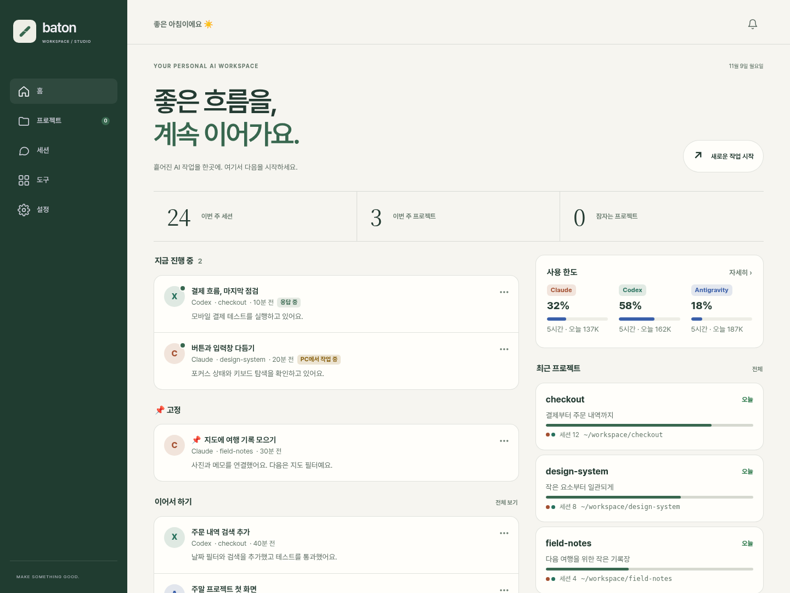
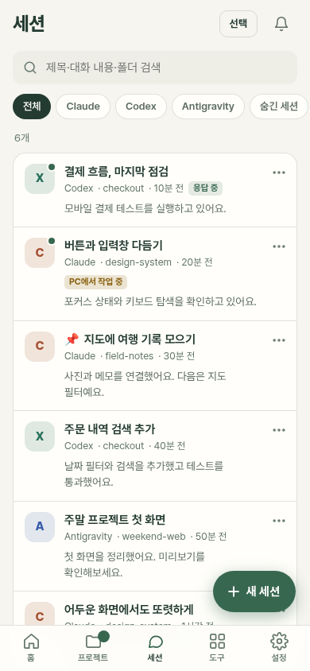

<div align="center">


# Baton

### 흩어진 AI 코딩 작업을, 하나의 흐름으로.

Claude Code · Codex · Antigravity · OpenCode (베타)<br>
**PC에서 시작한 작업을 모아 보고, 폰에서도 이어가세요.**

[](https://github.com/SongKye/baton/actions/workflows/ci.yml)
[](https://github.com/SongKye/baton/releases)
[](LICENSE)

[빠른 시작](#빠른-시작) · [왜 Baton인가요?](#왜-baton인가요) · [폰에서 쓰기](#폰에서-쓰기) · [사용 가이드](docs/guide.ko.md)

[English](README.md) · **한국어**

</div>

Baton은 **내 컴퓨터에서 실행하는 AI 코딩 대시보드**예요. 각 도구가 남긴 세션을 읽어 한곳에 모으고, 쓰던 CLI로 대화를 이어갑니다. CLI 설치부터 프로젝트별 세션·연결된 서비스·MCP 관리까지, 작업에 필요한 것들을 한곳에 모아줘요.

| 설치는 버튼으로 | 관리는 프로젝트별로 | 도구 설정도 간단하게 |
|:---|:---|:---|
| CLI 설치부터 로그인·연결 확인까지 | 세션·연동 서비스·MCP를 한곳에 | 여러 CLI에 MCP를 간편하게 추가 |

[](docs/images/desktop-ko.png)

<sub>실제 Baton UI에 예시 데이터를 넣은 화면입니다. Forest 테마 · PC 화면. 이미지를 누르면 크게 볼 수 있어요.</sub>

## 빠른 시작

**설치 명령 한 줄 → 브라우저에서 AI 연결 → 첫 대화.** 별도 빌드나 데이터베이스 설치는 필요 없어요.

### 1. 설치하기

**macOS · Linux · WSL** — 터미널에 붙여넣으세요.

```bash
curl -fsSL https://raw.githubusercontent.com/SongKye/baton/main/scripts/install.sh | bash
```

**Windows** — PowerShell에 붙여넣으세요.

```powershell
irm https://raw.githubusercontent.com/SongKye/baton/main/scripts/install.ps1 | iex
```

Git과 **Node.js 22.13 이상**이 필요해요. Node.js가 없으면 설치 스크립트가 설치를 도와줘요. macOS·Linux·WSL은 Git을 먼저 준비하고, Windows는 `winget`이 있으면 Git 설치도 안내해요. [설치 도움말 · WSL · ZIP](docs/guide.ko.md#빠른-시작)

### 2. 클릭으로 코딩 도구 셋업하기

대시보드의 **시작하기 → AI 연결**에서 쓸 도구를 고르고 **설치**를 누르세요. 각 도구의 공식 설치 방식으로 설치를 진행하고, 로그인과 연결 테스트까지 안내해요. 로그인은 도구에 따라 브라우저나 터미널에서 마무리합니다. 설치 가능 여부는 OS에 따라 달라져요.

구독 계정 외에 API 키·회사 계정·로컬 모델도 연결할 수 있어요.

이미 쓰고 있던 CLI가 있다면 기존 세션이 자동으로 나타나요.

### 3. 이어서 작업하기

**세션**에서 기존 대화를 열거나 **새 세션**에서 도구와 작업 폴더를 고르고 메시지를 보내세요. 첫 답변이 오면 준비 끝이에요.

| 다시 열기 | 방법 |
|---|---|
| macOS · Linux · WSL | 터미널에서 `baton` |
| Windows | 시작 메뉴 또는 바탕화면의 **Baton** 아이콘 |
| 로그인할 때 자동 실행 | **시작하기 → 자동 시작** 켜기 |

<sub>기본 설치 위치는 사용자 홈의 `baton` 폴더예요. 기본 주소는 macOS·Linux·WSL에서 <a href="http://localhost:7420">localhost:7420</a>, Windows에서 <a href="http://localhost:7421">localhost:7421</a>이며, 포트가 사용 중이면 다른 포트를 골라요. 실제 주소는 터미널에 표시됩니다. Codex·Antigravity를 Windows에서 쓴다면 <a href="docs/guide.ko.md#windows-wsl에-설치하기-단계별">WSL 설치 안내</a>도 확인하세요.</sub>

## 왜 Baton인가요?

**코딩 도구를 준비하고, 프로젝트를 살펴보고, 작업을 이어가는 과정을 한곳에서.**

| 편리한 점 | 이렇게 쓸 수 있어요 |
|---|---|
| **코딩 도구를 버튼으로 설치** | 설치 명령을 따로 찾지 않고, 시작하기 화면에서 CLI 설치·로그인·연결 테스트를 진행해요. |
| **프로젝트별로 작업 한눈에 보기** | 여러 CLI의 세션, GitHub 저장소, Vercel·Firebase·Supabase 등 연결된 서비스의 대시보드 링크, 개발 서버와 적용되는 MCP를 모아 봐요. |
| **백그라운드 작업까지 확인** | 터미널에서 진행 중인 세션과 다른 도구가 백그라운드로 실행한 세션을 확인하고, 진행 상황을 따라가요. |
| **쌓인 세션을 쉽게 정리** | 제목·대화·폴더로 검색하고, 중요한 세션은 고정해요. 정리 후보를 모아 보거나 여러 세션을 선택해 숨기고 휴지통으로 옮길 수 있어요. |
| **MCP도 간편하게 셋업** | 목록에서 서버와 사용할 CLI를 골라 추가하고, 기존 설정을 다른 CLI에도 복사해요. 프로젝트별 적용 설정·연결 상태·실제 호출 기록도 확인해요. |
| **다음 작업으로 바로 이어가기** | 프로젝트 브리핑으로 완료한 일과 다음 할 일을 확인해요. 도구별 사용 한도를 살피고, 필요하면 작업 맥락을 정리해 다른 CLI로 넘겨요. |
| **폰에서도 작업 이어가기** | 완료·질문 알림을 받고, 대화·사진 전송·질문 응답을 폰에서 이어가요. |

스킬 사용 기록과 개발 서버 켜기·끄기도 지원해요. [기능별 사용법 →](docs/guide.ko.md)

## 폰에서 쓰기

<table>
<tr>
<td width="300" align="center">

</td>
<td valign="top">
<h3>PC의 작업을, 손안에서 이어가세요.</h3>
<p>세션을 찾아 대화하고, 사진을 보내고, AI가 물어보는 선택지에 답할 수 있어요. 응답이 끝나면 알림으로 확인하세요.</p>
<ol>
<li>PC와 폰에 <b>Tailscale</b>을 설치하고 같은 계정으로 로그인</li>
<li><b>시작하기 → 폰 연결 → 내 기기에 공유</b>에서 QR 코드 스캔</li>
<li>폰의 <b>홈 화면에 추가</b>하고 알림 켜기</li>
</ol>
<p>내 Tailscale 네트워크 안에서 접속해요. 작업을 이어가려면 <b>PC와 Baton이 켜져 있어야 해요.</b> iOS 알림은 홈 화면에 추가한 앱에서 사용할 수 있어요.</p>
<p><a href="docs/guide.ko.md#폰에서-쓰기">폰 연결 자세히 →</a></p>
<sub>실제 모바일 UI · 예시 데이터</sub>
</td>
</tr>
</table>

## 지원하는 도구

| 도구 | 기존 세션 · 대화 · 새 세션 | 사진 | 실시간 한도 | 토큰 사용량 |
|---|:---:|:---:|:---:|:---:|
| **Claude Code** | ✓ | ✓ | ✓ | ✓ |
| **Codex** | ✓ | ✓ | ✓ | ✓ |
| **Antigravity** | ✓ | ✓ | ✓ | ✓ |
| **OpenCode** | 베타 | ✓ | — | ✓ |

OpenCode는 베타이며, 실제 설치 환경 검증 전이에요. 기능은 CLI와 연결 방식에 따라 달라져요.

**Cursor — 미검증 · 공식 지원 대상 아님.** 연동 코드는 있지만 직접 테스트·검증하지 않았고, 현재 정식 지원 계획도 없어요. 동작을 보장하지 않아 위 지원 목록에서는 제외했습니다.

구독 외에도 **API 키 · Bedrock · Vertex · Azure OpenAI · 사내 게이트웨이 · 로컬 모델**을 지원해요. 연결 방식마다 맞는 CLI가 있어요. [연결 방식별 안내 →](docs/guide.ko.md#내-모델-연결하기)

## 내 컴퓨터에서 어떻게 동작하나요?

Baton은 **Node.js 서버 + 브라우저 UI**로 동작해요. CLI의 세션 파일을 읽고, 메시지를 보내면 해당 CLI를 실행해요. Baton의 설정·고정·브리핑은 설치 폴더의 `data/`에 저장됩니다. AI 요청은 선택한 CLI와 연결한 공급자를 통해 처리돼요.

기본 접속 주소는 `127.0.0.1`이고, 폰 연결에는 Tailscale을 사용해요. [접근 제어와 보안 →](SECURITY.md)

## 더 알아보기

| 필요한 내용 | 안내 |
|---|---|
| 설치 · WSL · ZIP · 다시 실행 | [설치 가이드](docs/guide.ko.md#빠른-시작) |
| 내 모델 · 회사 환경 · MCP | [사용 가이드](docs/guide.ko.md#내-모델-연결하기) |
| 업데이트 · 문제 해결 | [업데이트](docs/guide.ko.md#업데이트) · [문제 해결](docs/guide.ko.md#문제-해결) |
| 개발 참여 · 변경 내역 | [기여 안내](CONTRIBUTING.md) · [Changelog](CHANGELOG.md) |

[MIT 라이선스](LICENSE) · 자유롭게 사용·수정·배포할 수 있어요. 저작권 표시를 유지해주세요.
