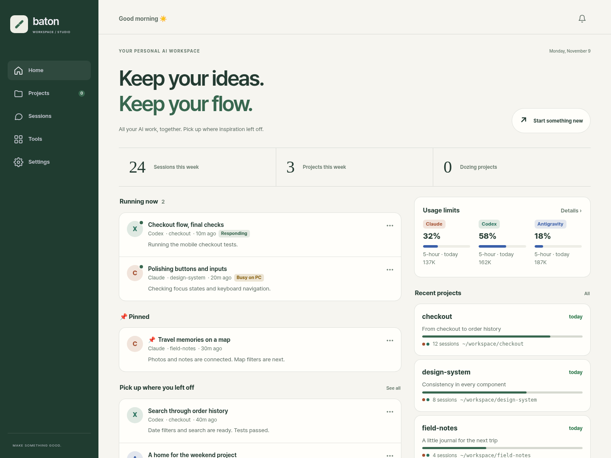
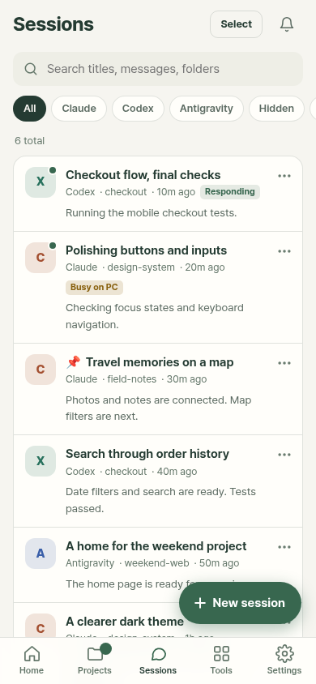

<div align="center">


# Baton

### Many coding agents. One place to pick up where you left off.

Claude Code · Codex · Antigravity · OpenCode (beta)<br>
**Bring your AI work together. Keep it moving from your desktop or phone.**

[](https://github.com/SongKye/baton/actions/workflows/ci.yml)
[](https://github.com/SongKye/baton/releases)
[](LICENSE)

[Quick start](#quick-start) · [Why Baton?](#why-baton) · [On your phone](#on-your-phone) · [User guide](docs/guide.md)

**English** · [한국어](README.ko.md)

</div>

Baton is an **AI coding dashboard that runs on your computer**. It brings together the sessions your tools already write and runs those same CLIs when you continue a conversation. From CLI installation to sessions, connected services and MCP configuration, keep what you need organized by project.

| Install with a click | Organize by project | Set up your tools easily |
|:---|:---|:---|
| CLI installation, sign-in and connection checks | Sessions, service links and MCP in one place | Add MCP servers across multiple CLIs |

[](docs/images/desktop-en.png)

<sub>Real Baton UI with fictional example data. Forest theme · desktop view. Click the image for a closer look.</sub>

## Quick start

**One install command → connect your AI in the browser → start a conversation.** No build step or separate database to install.

### 1. Install

**macOS · Linux · WSL** — paste into your terminal:

```bash
curl -fsSL https://raw.githubusercontent.com/SongKye/baton/main/scripts/install.sh | bash
```

**Windows** — paste into PowerShell:

```powershell
irm https://raw.githubusercontent.com/SongKye/baton/main/scripts/install.ps1 | iex
```

Requires Git and **Node.js 22.13+**. The setup script can help install Node.js. On macOS, Linux and WSL, install Git first; on Windows, the installer offers to install Git if `winget` is available. [Installation help · WSL · ZIP](docs/guide.md#quick-start)

### 2. Set up your coding tools with a click

In **Get started → Connect AI**, choose a tool and press **Install**. Baton uses its official installation method and guides you through sign-in and connection testing. Depending on the tool, you finish sign-in in a browser or terminal. Installation availability varies by OS.

You can also connect an API key, company account or local model instead of a subscription.

Already using a CLI? Its existing sessions appear automatically.

### 3. Pick up your work

Open an existing conversation in **Sessions**, or choose **New session**, pick a tool and working folder, and send a message. When the first reply arrives, you're ready.

| Open it again | How |
|---|---|
| macOS · Linux · WSL | Type `baton` in a terminal |
| Windows | Click **Baton** in the Start menu or on the desktop |
| Start automatically | Enable **Get started → Start on login** |

<sub>Installs into the <code>baton</code> folder in your home directory. The default address is <a href="http://localhost:7420">localhost:7420</a> on macOS/Linux/WSL and <a href="http://localhost:7421">localhost:7421</a> on Windows. If the port is busy, Baton picks another; the terminal prints the actual address. Using Codex or Antigravity on Windows? See the <a href="docs/guide.md#windows-install-in-wsl-step-by-step">WSL setup guide</a>.</sub>

## Why Baton?

**Set up your coding tools, see each project's work and keep it moving—all in one place.**

| What gets easier | What you can do |
|---|---|
| **Install coding tools with a click** | Install CLIs, sign in and test connections from Get started, without hunting down installation commands. |
| **See everything by project** | Bring together sessions across CLIs, the GitHub repository, dashboard links for services such as Vercel, Firebase and Supabase, dev servers and the project's effective MCP configuration. |
| **Follow background work** | See sessions running in your terminal, including sessions launched in the background by another tool, and follow their progress. |
| **Clean up sessions easily** | Search titles, conversations and folders; pin important sessions. Review cleanup candidates or select multiple sessions to hide or move to the trash. |
| **Set up MCP without the repetition** | Choose a server and the CLIs to add it to, or copy an existing configuration to another CLI. Inspect project settings, connection status and actual tool calls. |
| **Pick up the next task** | Read a project brief of what's done and what's next. Check tool limits and hand work to another CLI with a summary of the context when needed. |
| **Continue from your phone** | Get completion and question alerts, continue chatting, send photos and answer the agent's questions. |

Skill usage and dev server start/stop controls are also included. [Explore the features →](docs/guide.md)

## On your phone

<table>
<tr>
<td width="300" align="center">

</td>
<td valign="top">
<h3>Your desktop work, within reach.</h3>
<p>Find a session, continue a conversation, send a photo or answer the agent's questions. Get a notification when the reply is ready.</p>
<ol>
<li>Install <b>Tailscale</b> on your computer and phone; sign in with the same account.</li>
<li>Open <b>Get started → Phone → Share to my devices</b> and scan the QR code.</li>
<li><b>Add to Home Screen</b> and enable notifications.</li>
</ol>
<p>Connect through your own Tailscale network. <b>Your computer and Baton must stay running.</b> On iOS, notifications require adding the app to your home screen.</p>
<p><a href="docs/guide.md#use-it-from-your-phone">Phone setup details →</a></p>
<sub>Real mobile UI · fictional example data</sub>
</td>
</tr>
</table>

## Supported tools

| Tool | Existing sessions · chat · new sessions | Photos | Live limits | Token usage |
|---|:---:|:---:|:---:|:---:|
| **Claude Code** | ✓ | ✓ | ✓ | ✓ |
| **Codex** | ✓ | ✓ | ✓ | ✓ |
| **Antigravity** | ✓ | ✓ | ✓ | ✓ |
| **OpenCode** | Beta | ✓ | — | ✓ |

OpenCode is in beta and has not yet been verified against a live install. Capabilities depend on the CLI and backend.

**Cursor — unverified and not officially supported.** Integration code exists, but it has not been directly tested or validated, and there are currently no plans for official support. It is excluded from the supported list above because its behavior is not guaranteed.

Bring a subscription, **API key, Bedrock, Vertex, Azure OpenAI, company gateway or local model**. Each backend connects through a compatible CLI. [Choose your connection →](docs/guide.md#bring-your-own-model)

## How it runs

Baton is a **Node.js server and browser UI**. It reads CLI session files and runs the corresponding CLI when you send a message. Its settings, pins and briefs live in the installation's `data/` folder. AI requests go through your chosen CLI and its configured provider.

Baton listens on `127.0.0.1` by default; phone access uses Tailscale. [Access control and security →](SECURITY.md)

## Find out more

| Looking for… | Read |
|---|---|
| Installation · WSL · ZIP · reopening | [Installation guide](docs/guide.md#quick-start) |
| Your own models · company setup · MCP | [User guide](docs/guide.md#bring-your-own-model) |
| Updates · troubleshooting | [Updates](docs/guide.md#updates) · [Troubleshooting](docs/guide.md#troubleshooting) |
| Contributing · release history | [Contributing](CONTRIBUTING.md) · [Changelog](CHANGELOG.md) |

[MIT licensed](LICENSE) · Free to use, modify and share. Keep the copyright notice.
